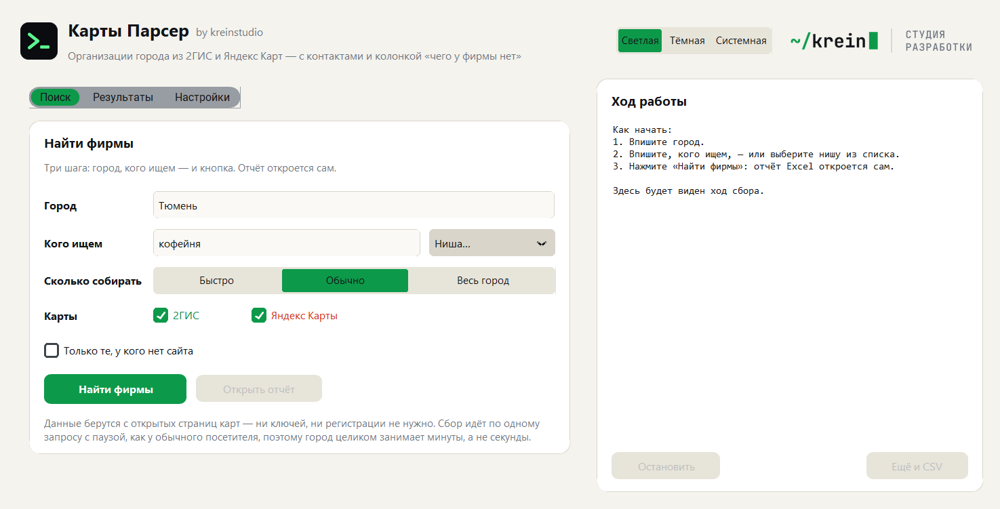
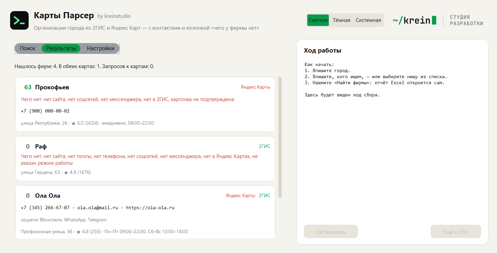
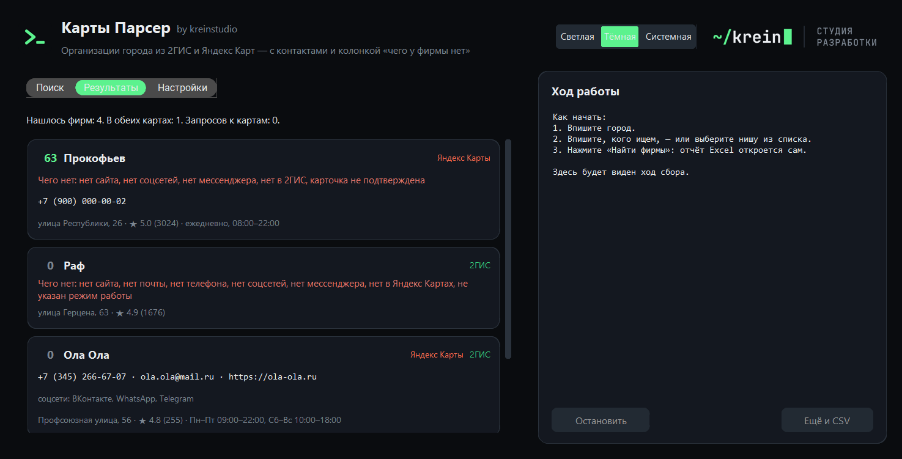

<a href="https://kreinstudio.ru/">
  <picture>
    <source media="(prefers-color-scheme: dark)" srcset="assets/brand/logo-dark@2x.png">
    
  </picture>
</a>

# Парсер 2ГИС и Яндекс Карт — организации города в Excel: телефоны, почты, сайты и чего у фирмы нет

[](https://github.com/krein15/maps-parser/actions/workflows/tests.yml)

Программа собирает организации города из [2ГИС](https://2gis.ru) и [Яндекс Карт](https://yandex.ru/maps),
сводит одну и ту же фирму из двух карт в одну строку и складывает всё в Excel: название, адрес, телефон,
**почта**, сайт, соцсети и мессенджеры, рейтинг, число отзывов, режим работы и ссылки на карточки.

И ещё одна колонка, которой нет ни у одного парсера карт, — **«чего у фирмы нет»**.

> **Статус: версия 0.1.** Работают обе карты, сведение фирм, пробелы с оценкой, отчёт Excel и CSV, окно и
> командная строка. Разведка источников с проверенными потолками — [docs/recon.md](docs/recon.md).

[Скачать программу для Windows](https://github.com/krein15/maps-parser/releases/latest) — Python не нужен.
[Пример отчёта](docs/example/example-report.xlsx).



## Зачем колонка «чего у фирмы нет»

Обычный парсер карт отдаёт то, что у фирмы **есть**: вот название, вот телефон, вот адрес. Для холодных
продаж ценнее обратное. Когда собираешь шестёрку фирм в своей нише, самым полезным оказывается не их
телефон, а то, что у двоих нет почты вообще, а у одного нет сайта — при тридцати девяти отзывах. Это и есть
крючок: сразу видно, с чем к ним заходить.

Программа считает по каждой фирме тринадцать видов пробелов:

| Пробел | С чем заходить |
|---|---|
| нет сайта | сделать сайт или хотя бы страницу-визитку |
| нет почты | писать некуда — только звонок или мессенджер |
| нет соцсетей | нет площадки, где показывают работы |
| нет мессенджера | заявку некуда написать с телефона |
| нет в Яндекс Картах / нет в 2ГИС | фирму не находят в одной из карт |
| нет отзывов, мало отзывов | карточку никто не ведёт |
| рейтинг ниже 4 | репутацию надо чинить |
| карточка не подтверждена | владелец её не забрал |
| нет фотографий | фирму не видно глазами |
| не указан режим работы | клиент не знает, когда приходить |

Каждому пробелу назначен вес, из них складывается **оценка от 0 до 100**: чем больше у фирмы дыр, тем выше
она в списке обзвона. Если связаться не с кем вообще — ни телефона, ни почты, ни соцсетей — оценка нулевая,
сколько бы пробелов ни нашлось: такая строка в списке бесполезна.

Два правила, из-за которых пробелы считаются честно, а не «в лоб»:

- **«Нет почты» пишется, только если фирму видел 2ГИС.** Яндекс почту не публикует никогда, и по его данным
  вывод был бы о пробеле источника, а не о фирме.
- **«Нет в 2ГИС» пишется, только если 2ГИС показал по запросу всё.** Если сбор упёрся в заданное число фирм,
  отсутствие ничего не доказывает.



## Что внутри отчёта

Лист **«Фирмы»** — строка на фирму: название, чего нет, оценка, что с этим делать, рубрика, адрес, телефоны,
почты, сайты, соцсети и мессенджеры, рейтинг, число оценок, режим работы, какие карты её знают, ссылки на
карточку в каждой карте и координаты. Фильтры и закрепление шапки уже включены, оценка подсвечена шкалой.

Лист **«Сводка»** — разбор сбора: что искали, где, сколько фирм нашлось, сколько из них есть в обеих картах,
сколько было запросов, сколько заняло времени, упёрся ли источник в свой потолок и каких пробелов сколько.

Рядом с Excel по желанию кладётся CSV с разделителем «точка с запятой» и BOM — он открывается двойным
щелчком в русском Excel и заливается в CRM.

## Откуда берутся данные

Из открытых страниц обеих карт — тех самых, которые видит любой человек, открывший 2ГИС или Яндекс Карты в
браузере. **Ни ключей API, ни регистрации, ни браузера внутри программы не нужно:** обе карты собирают
страницы на сервере и отдают готовые данные обычному HTTP-запросу. Поэтому программа весит сорок мегабайт,
а не триста, и работает заметно быстрее парсеров на Selenium.

Карты дополняют друг друга, и это главное, что даёт сбор сразу из двух:

| | 2ГИС | Яндекс Карты |
|---|---|---|
| Организаций за один запрос | 12, максимум 5 страниц | 25, листается далеко |
| Контакты | только в карточке фирмы | сразу в выдаче |
| Почта | **есть** | нет никогда |
| Подтверждена ли карточка | не показывает | показывает |
| Сколько фотографий | не показывает | показывает |

Яндекс даёт объём дёшево, 2ГИС — почты и соцсети, но по запросу на фирму. Сведённые вместе, они дают строку
полнее, чем любая из карт по отдельности.

**Про потолки честно.** Выдача 2ГИС отдаёт не больше 60 организаций на запрос — поэтому при большом сборе
программа режет город на участки по карте и обходит их по очереди. Выдача Яндекса листается, пока приходят
новые фирмы. В сводке отчёта прямо написано, упёрся ли источник в свой потолок: «выгрузили всё» — обещание,
которого карты не дают никому.

Сбор идёт в один поток с паузой между запросами, как у обычного посетителя: разделы, закрытые в `robots.txt`,
не трогаются, защита не обходится, капча не ломается. Собираются сведения об организациях, которые они сами
опубликовали на карте, — не персональные данные частных лиц.

## Окно

```bash
pip install -r requirements.txt
python app.py
```

Первый экран — три шага: город, кого ищем, кнопка «Найти фирмы». Отчёт Excel открывается сам.

- **Поиск** — город с подсказкой, ниша из готового списка (кофейня, автосервис, стоматология, салон красоты,
  ремонт квартир, грузоперевозки и ещё два десятка) или своё слово, объём сбора, галочки карт и фильтр
  «только те, у кого нет сайта».
- **Результаты** — карточки фирм: оценка, чего не хватает, контакты, рейтинг, режим работы; по щелчку на
  название карты открывается карточка фирмы в 2ГИС или Яндексе.
- **Настройки** — пауза между запросами, папка отчётов, открывать ли отчёт сразу, нужно ли открывать карточки
  2ГИС ради почты, кэш страниц.

Справа — ход работы и кнопка «Остановить»: собранное к этому моменту сохраняется. Тёмная тема переключается
в шапке.



## Командная строка

Всё то же самое доступно из консоли — удобно для запуска по расписанию:

```bash
python -m mapsparser collect -q кофейня -c Тюмень
```

```bash
python -m mapsparser collect -q автосервис -c Казань --gap website --limit 600 --csv
```

| Команда | Что делает |
|---|---|
| `collect` | собрать фирмы и сделать отчёт |
| `cities` | города, которые программа знает |
| `sources` | какие карты подключены и что каждая отдаёт |
| `gaps` | какие пробелы умеет находить и сколько весит каждый |
| `cache` | сохранённые страницы: размер, очистить |

Полезные ключи `collect`: `--source 2gis` (только одна карта), `--limit` (сколько брать с каждой карты),
`--gap website` (оставить только фирмы без сайта), `--min-score 40`, `--no-deep` (быстро, но без почт),
`--delay` (пауза между запросами), `--csv`, `--out`, `--open`.

Собранный `MapsParser.exe` работает так же: без аргументов открывает окно, с аргументами — командная строка.

## Города

В справочнике больше ста городов России — все миллионники и большинство крупных. Яндексу название города
достаточно передать текстом, 2ГИС просит короткое имя в адресе (`2gis.ru/tyumen`), и эти имена проверены
на сайте. Нужного города нет — добавьте его одной командой:

```bash
python tools/update_cities.py Сургут
```

## Установка из исходников

```bash
git clone https://github.com/krein15/maps-parser.git
cd maps-parser
python -m venv .venv
.venv\Scripts\pip install -r requirements-dev.txt
.venv\Scripts\python app.py
```

Нужен Python 3.12 или новее. Сборка своей версии программы:

```bash
.venv\Scripts\python -m PyInstaller MapsParser.spec --noconfirm
```

## Как это проверено

```bash
.venv\Scripts\python -m pytest -q
```

Сто девятнадцать тестов, и ни один не ходит в сеть: они разбирают сохранённые страницы из `tests/fixtures`,
нарочно набитые ловушками настоящих источников — телефон через знак U+2012, сайт за счётчиком переходов
`link.2gis.ru`, ссылка на телеграм в поле «сайт», дом вместо организации в выдаче 2ГИС, рекламная подборка
и фирма из соседнего города у Яндекса. Отдельно проверено, что филиалы сети не слипаются в одну строку:
у сетевой кофейни на весь город один сайт и часто один телефон, и склеить их — значит соврать в отчёте.

Собранная программа проверена вживую: сбор по Тюмени дал 44 фирмы за 39 секунд, из них 14 с почтой.

## Добавить свою карту

Источник описывается одним объектом — ключ, название, цвет, сборщик и перечень того, что карта в принципе
умеет отдавать. Из этого описания собираются окно, флаги командной строки, колонки отчёта и логика пробелов;
ядро не знает ни одного источника по имени. Новая карта подключается точкой входа `mapsparser.sources` —
поставили пакет, и она появилась везде сама. Смотрите [mapsparser/sources/base.py](mapsparser/sources/base.py).

## Вопросы, которые задают первыми

**Это законно?** Программа читает открытые страницы карт так же, как это делает посетитель: не обходит
защиту, не ломает капчу, не лезет в разделы, закрытые в `robots.txt`, и собирает только те сведения об
организациях, которые они сами опубликовали. Официальные API сюда не годятся по условиям самих площадок:
Яндекс в API поиска по организациям прямо запрещает сохранять результаты, а у 2ГИС контакты в Places API —
отдельное платное разрешение на ключ. Подробнее — в [разведке](docs/recon.md).

**Чем отличается от других парсеров карт?** Тремя вещами: две карты сводятся в одну строку, у фирм
находятся почты (их отдаёт только 2ГИС), и есть колонка «чего у фирмы нет» с оценкой лида.

**Сколько занимает сбор?** Зависит от объёма. Две-три сотни фирм с открытием карточек 2ГИС — несколько минут.
Пауза между запросами настраивается, но уменьшать её без нужды не стоит: карты этого не любят.

**Можно ли собрать всю Россию разом?** Нет, и никакой парсер карт этого честно не обещает: обе выдачи
ограничены. Программа работает по городу и нише — так и задумано.

## Автор

Николай Бондаренко, [krein studio](https://kreinstudio.ru/) — разработка парсеров, ботов и программ под задачу.

- Telegram: [@krein1](https://t.me/krein1)
- Почта: kreinwork1@gmail.com
- Другие проекты: [парсер маркетплейсов](https://github.com/krein15/marketplace-parser),
  [парсер госзакупок](https://github.com/krein15/zakupki-parser)

Нужен сбор под вашу нишу, другой источник или выгрузка прямо в вашу CRM — напишите.

## Лицензия

[MIT](LICENSE) — пользуйтесь, меняйте, встраивайте в свои проекты.
