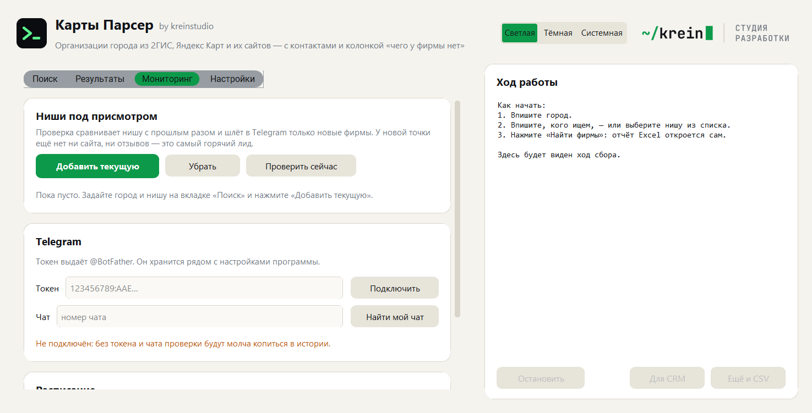

<a href="https://kreinstudio.ru/">
  <picture>
    <source media="(prefers-color-scheme: dark)" srcset="assets/brand/logo-dark@2x.png">
    
  </picture>
</a>

# Парсер 2ГИС и Яндекс Карт — организации города в Excel: телефоны, почты, сайты и чего у фирмы нет

[](https://github.com/krein15/maps-parser/actions/workflows/tests.yml)

Программа собирает организации города из [2ГИС](https://2gis.ru) и [Яндекс Карт](https://yandex.ru/maps),
заходит на сайт каждой найденной фирмы, сводит одно и то же заведение из разных источников в одну строку и
складывает всё в Excel: название, адрес, телефон (отдельно мобильный), **почта**, сайт, соцсети и мессенджеры,
рейтинг, число отзывов, режим работы, сеть, ИНН и ссылки на карточки.

И ещё одна колонка, которой нет ни у одного парсера карт, — **«чего у фирмы нет»**.

> **Статус: версия 0.2.** Работают три источника, ниши из нескольких запросов, пробелы с оценкой, отчёт Excel,
> CSV и файлы под импорт в CRM, история сборов, мониторинг новых фирм в Telegram, окно и командная строка.
> Разведка источников с проверенными потолками — [docs/recon.md](docs/recon.md).

[Скачать программу для Windows](https://github.com/krein15/maps-parser/releases/latest) — Python не нужен.
[Пример отчёта](docs/example/example-report.xlsx).


## Зачем колонка «чего у фирмы нет»

Обычный парсер карт отдаёт то, что у фирмы **есть**: вот название, вот телефон, вот адрес. Для холодных
продаж ценнее обратное. Когда собираешь шестёрку фирм в своей нише, самым полезным оказывается не их
телефон, а то, что у двоих нет почты вообще, а у одного нет сайта — при тридцати девяти отзывах. Это и есть
крючок: сразу видно, с чем к ним заходить.

Программа считает по каждой фирме семнадцать видов пробелов:

| Пробел | С чем заходить |
|---|---|
| нет сайта | сделать сайт или хотя бы страницу-визитку |
| **сайт не открывается** | за домен платят, а сайта нет — поднять |
| **сайт без https** | браузеры метят такой сайт небезопасным |
| **сайт не для телефона** | с телефона заходит большинство |
| **на сайте нет формы заявки** | заявку оставить негде |
| нет почты | писать некуда — только звонок или мессенджер |
| нет соцсетей, нет мессенджера | нет площадки, где показывают работы |
| нет в Яндекс Картах / нет в 2ГИС | фирму не находят в одной из карт |
| нет отзывов, мало отзывов | карточку никто не ведёт |
| рейтинг ниже 4 | репутацию надо чинить |
| карточка не подтверждена | владелец её не забрал |
| нет фотографий, не указан режим работы | фирму не видно, время работы неизвестно |

Каждому пробелу назначен вес, из них складывается **оценка от 0 до 100**: чем больше у фирмы дыр, тем выше
она в списке обзвона. Если связаться не с кем вообще — ни телефона, ни почты, ни соцсетей — оценка нулевая,
сколько бы пробелов ни нашлось: такая строка в списке бесполезна.

Три правила, из-за которых пробелы считаются честно, а не «в лоб»:

- **«Нет почты» пишется, только если её искали там, где она бывает** — в карточке 2ГИС или на сайте фирмы.
  Яндекс почту не публикует никогда, и по его данным вывод был бы о пробеле источника, а не о фирме.
- **«Нет в 2ГИС» пишется, только если 2ГИС показал по запросу всё.** Если сбор упёрся в заданное число фирм,
  отсутствие ничего не доказывает.
- **«Сайт не открывается» — это не то же самое, что «нет сайта».** Первое гораздо интереснее: фирма уже
  платит за домен и хостинг, просто не знает, что посетители туда не попадают.


## Три источника, которые дополняют друг друга

| | 2ГИС | Яндекс Карты | Сайт фирмы |
|---|---|---|---|
| Организаций за один запрос | 12, максимум 5 страниц | 25, листается далеко | — |
| Контакты | только в карточке фирмы | сразу в выдаче | в подвале и в «Контактах» |
| Почта | **есть** | нет никогда | **есть чаще всего** |
| Подтверждена ли карточка | не показывает | показывает | — |
| Сколько фотографий | не показывает | показывает | — |

Яндекс даёт объём дёшево, 2ГИС — почты и соцсети, но по запросу на фирму. Сайт добирает то, чего нет ни на
одной карте: в пробном сборе по Тюмени сайт был у 31 фирмы из 44, а почта — только у 14; после захода на
сайты почта нашлась у 22, то есть в полтора раза чаще. Заодно видно, что с самим сайтом.

Ключей API, регистрации и браузера внутри программы не нужно: обе карты собирают страницы на сервере и
отдают готовые данные обычным HTTP-запросом. Поэтому программа весит сорок мегабайт, а не триста, и
работает заметно быстрее парсеров на Selenium.

**Про потолки честно.** Выдача 2ГИС отдаёт не больше 60 организаций на запрос — поэтому при большом сборе
программа режет город на участки по карте и обходит их по очереди. Проверено живьём: «магазин» по
Екатеринбургу — 600 уникальных организаций за 59 запросов и полторы минуты, город резался на 24 участка.
Выдача Яндекса листается, пока приходят новые фирмы. В сводке отчёта прямо написано, упёрся ли источник в
свой потолок: «выгрузили всё» — обещание, которого карты не дают никому.

Сбор идёт в один поток с паузой между запросами, как у обычного посетителя: разделы, закрытые в `robots.txt`,
не трогаются, защита не обходится, капча не ломается. Собираются сведения об организациях, которые они сами
опубликовали на карте, — не персональные данные частных лиц.

## Ниша — это набор запросов, а не одно слово

Фирма сама решает, как себя назвать: одна пишется «автосервисом», соседняя — «СТО», третья — «ремонтом
автомобилей». По одному слову две трети ниши в выдачу не попадут.

В программе 22 готовые ниши — автосервисы, кафе и кофейни, стоматологии, салоны красоты, строительство и
ремонт, окна и потолки, мебель на заказ, грузоперевозки, клининг, юристы, бухгалтерия, типографии и реклама
и другие. Выбрал нишу — программа обойдёт все её запросы и сложит найденное в один список без повторов.

Ниши лежат в [mapsparser/templates](mapsparser/templates) обычными TOML-файлами и правятся текстовым
редактором: это отправная точка, а не истина — под свой город и ассортимент словарь доводится.

## Что внутри отчёта

Лист **«Фирмы»** — строка на фирму: название, чего нет, оценка, что с этим делать, рубрика, адрес, телефоны,
отдельно мобильные, почты, сайты, что с сайтом, соцсети и мессенджеры, рейтинг, число оценок, режим работы,
сеть, ИНН и дата регистрации, какие источники её знают, ссылки на карточки и координаты. Фильтры и
закрепление шапки включены, оценка подсвечена шкалой.

Лист **«Сводка»** — честный разбор сбора: что искали, где, сколько фирм нашлось, сколько из них есть в обеих
картах, сколько было запросов, сколько заняло времени, упёрся ли источник в свой потолок и каких пробелов
сколько.

Лист **«Изменения»** появляется со второго сбора по той же нише — о нём ниже.

Рядом с Excel по желанию кладутся CSV (точка с запятой и BOM — открывается двойным щелчком в русском Excel)
и файлы под импорт в **amoCRM** и **Битрикс24**: свои названия колонок, один телефон и одна почта в клетке,
а пробелы, рейтинг, соцсети и ссылки на карточки — в примечании, чтобы менеджер видел, с чем заходить.

## Что изменилось с прошлого раза

Один сбор — это снимок ниши на сегодня. Ценность появляется на втором: видно, кто в нише появился, у кого
наконец завёлся сайт, у кого он умер, где просел рейтинг, кто пропал из выдачи.

Фирма опознаётся по названию и месту, а не по номеру карточки: карта может потерять карточку или отдать её
под другим идентификатором, а фирма стоит на месте. Прерванный сбор в память не кладётся — в нём
«пропавшие» это те, до кого не дошли руки.

## Мониторинг: новые фирмы в Telegram

**Новая фирма — самый горячий лид из возможных:** сайта у неё ещё нет, отзывов нет, карточка не подтверждена,
и прямо сейчас кто-то решает, где это всё заказывать.

Добавьте нишу под присмотр, подключите бота — и программа будет проверять её по расписанию и присылать
**только новые** фирмы, а не весь список заново. Бот создаётся в [@BotFather](https://t.me/BotFather) за
минуту, номер чата программа находит сама. Расписание — задание Планировщика Windows: пропущенную проверку
(компьютер был выключен) оно догонит.



## Окно

```bash
pip install -r requirements.txt
python app.py
```

Первый экран — три шага: город, кого ищем, кнопка «Найти фирмы». Отчёт Excel открывается сам.

- **Поиск** — город с подсказкой, ниша из готового списка или своё слово, объём сбора, галочки карт и фильтры
  «только те, у кого нет сайта» и «без сетевых точек».
- **Результаты** — карточки фирм: оценка, чего не хватает, контакты, рейтинг, режим работы; по щелчку на
  название карты открывается карточка фирмы в 2ГИС или Яндексе.
- **Мониторинг** — ниши под присмотром, подключение бота, расписание проверок.
- **Настройки** — пауза между запросами, папка отчётов, заходить ли на сайты фирм, открывать ли карточки
  2ГИС ради почты, кэш страниц.

Справа — ход работы и кнопка «Остановить»: собранное к этому моменту сохраняется. Тёмная тема переключается
в шапке.


## Командная строка

Всё то же самое доступно из консоли — удобно для запуска по расписанию:

```bash
python -m mapsparser collect -q кофейня -c Тюмень
```

```bash
python -m mapsparser collect --niche Автосервисы -c Казань --gap website --crm amo
```

| Команда | Что делает |
|---|---|
| `collect` | собрать фирмы и сделать отчёт |
| `niches` | готовые ниши и их запросы |
| `cities` | города, которые программа знает |
| `sources` | какие карты подключены и что каждая отдаёт |
| `gaps` | какие пробелы умеет находить и сколько весит каждый |
| `watch` | ниши под присмотром: добавить, убрать, показать |
| `monitor` | проверить ниши и прислать новые фирмы в Telegram |
| `schedule` | проверки по расписанию: включить, выключить, состояние |
| `telegram` | бот и чат для уведомлений |
| `history` | память о прошлых сборах |
| `cache` | сохранённые страницы: размер, очистить |

Полезные ключи `collect`: `--niche` (ниша целиком), `--source 2gis` (только одна карта), `--limit`,
`--gap website` (оставить только фирмы без сайта), `--min-score 40`, `--no-chains` (без сетевых точек),
`--no-deep` (быстро, но без почт из 2ГИС), `--no-sites` (не заходить на сайты), `--inn` (искать ИНН в ЕГРЮЛ),
`--delay`, `--csv`, `--crm all`, `--out`, `--open`.

Собранный `MapsParser.exe` работает так же: без аргументов открывает окно, с аргументами — командная строка.

## Города

В справочнике 171 город России — все миллионники и большинство крупных. Яндексу название города достаточно
передать текстом, 2ГИС просит короткое имя в адресе (`2gis.ru/tyumen`), и эти имена проверены на сайте.

Шестьдесят три города — спутники: Химки, Мытищи, Копейск, Пятигорск и другие живут внутри чужого проекта
2ГИС («Москва», «Челябинск», «КавМинВоды»), но свой адрес у них есть, и поиск по нему сужается правильно.

Города нет в справочнике — сбор всё равно пойдёт: Яндекс найдёт его по названию, 2ГИС пропустится с
сообщением. А можно добавить город одной командой:

```bash
python tools/update_cities.py Сургут
```

## Установка из исходников

```bash
git clone https://github.com/krein15/maps-parser.git
cd maps-parser
python -m venv .venv
.venv\Scripts\pip install -r requirements-dev.txt
.venv\Scripts\python app.py
```

Нужен Python 3.12 или новее. Сборка своей версии программы:

```bash
.venv\Scripts\python -m PyInstaller MapsParser.spec --noconfirm
```

## Как это проверено

```bash
.venv\Scripts\python -m pytest -q
```

Двести одиннадцать тестов, и ни один не ходит в сеть: они разбирают сохранённые страницы из `tests/fixtures`,
нарочно набитые ловушками настоящих источников — телефон через знак U+2012, сайт за счётчиком переходов
`link.2gis.ru`, ссылка на телеграм в поле «сайт», дом вместо организации в выдаче 2ГИС, рекламная подборка
и фирма из соседнего города у Яндекса.

Отдельно закреплено то, на чём такие парсеры обычно врут: филиалы сети не слипаются в одну строку
(у сетевой кофейни на весь город один сайт и часто один телефон), ИНН не приписывается однофамильцу из
другого региона, «нет в 2ГИС» не пишется при неполном сборе.

Есть и вторая проверка — **канарейка**: раз в неделю отдельное задание ходит в сеть и убеждается, что обе
карты отдают данные в прежнем виде, включая сам потолок в пять страниц. Без неё смена формата у источника
осталась бы зелёной в тестах и сломанной у пользователя.

```bash
.venv\Scripts\python -m pytest -m live -q
```

## Добавить свою карту

Источник описывается одним объектом — ключ, название, цвет, сборщик, нужен ли ему свой адрес города и
перечень того, что карта в принципе умеет отдавать. Из этого описания собираются окно, флаги командной
строки, колонки отчёта и логика пробелов; ядро не знает ни одного источника по имени. Новая карта
подключается точкой входа `mapsparser.sources`. Смотрите [mapsparser/sources/base.py](mapsparser/sources/base.py).

## Вопросы, которые задают первыми

**Это законно?** Программа читает открытые страницы так же, как это делает посетитель: не обходит защиту,
не ломает капчу, не лезет в разделы, закрытые в `robots.txt`, и собирает только те сведения об организациях,
которые они сами опубликовали. Официальные API сюда не годятся по условиям самих площадок: Яндекс в API
поиска по организациям прямо запрещает сохранять результаты, а у 2ГИС контакты в Places API — отдельное
платное разрешение на ключ. Подробнее — в [разведке](docs/recon.md).

**Чем отличается от других парсеров карт?** Тремя вещами: несколько источников сводятся в одну строку, у фирм
находятся почты (их отдаёт 2ГИС и собственный сайт фирмы), и есть колонка «чего у фирмы нет» с оценкой лида.

**Почему ИНН находится не у всех?** На карте у фирмы вывеска, а в реестре — юридическое название: «Кофе Брют»
против «ООО „Сёрф Кофе Тюмень“». Программа ставит ИНН только при строгом совпадении названия и региона, и
если кандидат один. Приписать фирме чужой ИНН хуже, чем оставить клетку пустой.

**Сколько занимает сбор?** Зависит от объёма. Две-три сотни фирм с карточками 2ГИС и заходом на сайты —
несколько минут. Пауза между запросами настраивается, но уменьшать её без нужды не стоит.

**Можно ли собрать всю Россию разом?** Нет, и никакой парсер карт этого честно не обещает: обе выдачи
ограничены. Программа работает по городу и нише — так и задумано.

## Автор

Николай Бондаренко, [krein studio](https://kreinstudio.ru/) — разработка парсеров, ботов и программ под задачу.

- Telegram: [@krein1](https://t.me/krein1)
- Почта: kreinwork1@gmail.com
- Другие проекты: [парсер маркетплейсов](https://github.com/krein15/marketplace-parser),
  [парсер госзакупок](https://github.com/krein15/zakupki-parser)

Нужен сбор под вашу нишу, другой источник или выгрузка прямо в вашу CRM — напишите.

## Лицензия

[MIT](LICENSE) — пользуйтесь, меняйте, встраивайте в свои проекты.
